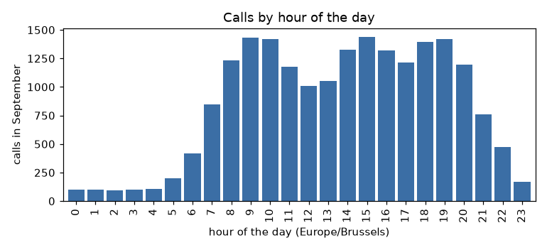
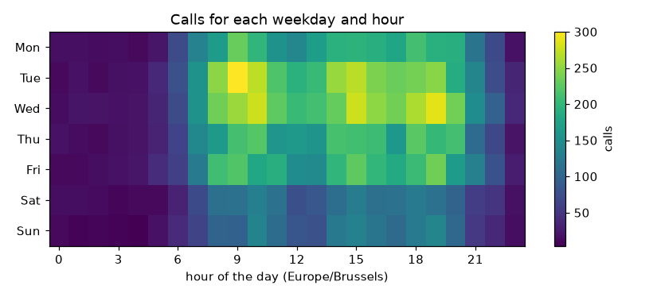
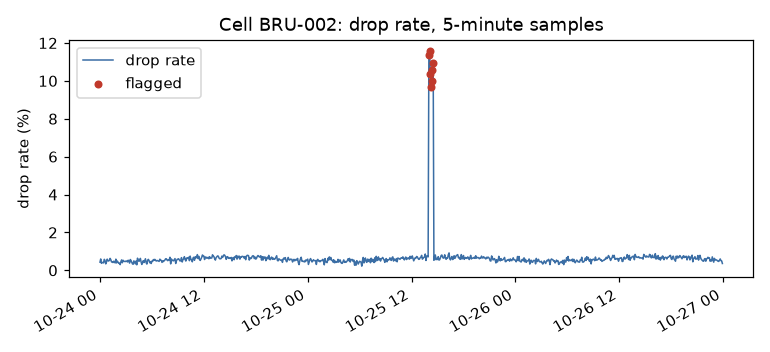
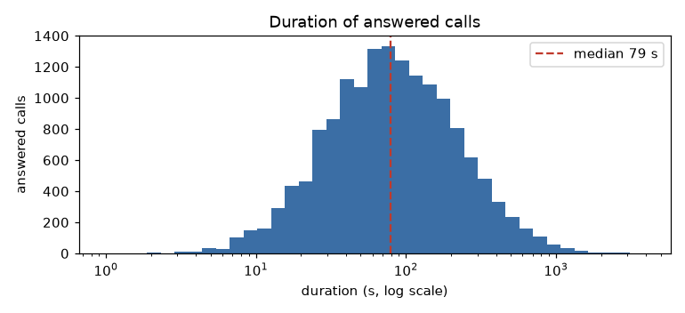

# 21. Plots

> **Build** — `pdbook/plots.py`: four plots of the call data (calls by hour, a traffic heat map, a KPI series with flagged samples, a duration histogram), each tested by the data that it holds, and each saved as a file in `figures/`.
>
> **Theory kept** — `DataFrame.plot` and `Series.plot` call matplotlib. A plot is a function of a table: shape the table first, then plot. Give each plot a title, axis labels with units and the zone of time. Test a plot with the numbers that are in it, and look at it once.
>
> **Source** — New. Library: [`pdbook/plots.py`](../pdbook/plots.py). Matplotlib is the one extra package that this book installs.
>
> **Run this first** — `uv run python -m examples.ch21_plots`, which is [`examples/ch21_plots.py`](../examples/ch21_plots.py). It writes four files to [`figures/`](../figures/). Exercises: [`exercises/21.md`](../exercises/21.md). Solutions: [`exercises/solutions/21.md`](../exercises/solutions/21.md).

## Shape the table, then plot

pandas plots a Series or a DataFrame with `.plot`, and a method for each kind: `.plot.bar()`, `.plot.line()`, `.plot.hist()`, `.plot.scatter()`. The index becomes the x axis and each column becomes a series. This means that most of the work is in the table (Chapters 8 to 10), and the plot is one line.

```python
import matplotlib

matplotlib.use("Agg")

from pdbook.io import load_calls

calls = load_calls()
hours = calls["start"].dt.tz_convert("Europe/Brussels").dt.hour
per_hour = hours.value_counts().reindex(range(24), fill_value=0).sort_index()
ax = per_hour.plot.bar()

print(type(ax).__name__, len(ax.patches))
print([int(p.get_height()) for p in ax.patches][:6])
print(per_hour.iloc[:6].tolist())
```

```text
Axes 24
[98, 102, 94, 101, 109, 199]
[98, 102, 94, 101, 109, 199]
```

`plot.bar` returns a matplotlib `Axes`. The 24 bars are `patches`, and their heights are the numbers of the Series. Two things in the code come from earlier chapters: the conversion to local time ([Chapter 12](12-dates-and-resampling.md)), and `reindex` so that an hour without calls is a bar of height 0 ([Chapter 11](11-index-and-multiindex.md)).

Choose `matplotlib.use("Agg")` on a server, in a job, or in a test. It draws to a file and needs no display.

#### `pd.Series.plot.bar`

```text
pd.Series.plot.bar(
    self,
    x=None,
    y=None,
    color=None,
    **kwargs,
)
```

The method draws a bar for each value, at the positions 0, 1, 2 and so on, with the index labels on the ticks. It returns the matplotlib `Axes`.

The table under `pd.Series.plot.bar` in the Reference section of this chapter gives each parameter and what goes wrong with it.

The functions of [`pdbook/plots.py`](../pdbook/plots.py) make their figure with `plt.subplots` and write it with `Figure.savefig`.

#### `plt.subplots`

```text
plt.subplots(
    nrows=1,
    ncols=1,
    *,
    sharex=False,
    sharey=False,
    squeeze=True,
    width_ratios=None,
    height_ratios=None,
    subplot_kw=None,
    gridspec_kw=None,
    **fig_kw,
)
```

The matplotlib function makes a `Figure` and a grid of `Axes`, and returns the pair `(figure, axes)`.

The table under `plt.subplots` in the Reference section of this chapter gives each parameter and what goes wrong with it.

#### `plt.Figure.savefig`

```text
plt.Figure.savefig(
    self,
    fname,
    *,
    transparent=None,
    **kwargs,
)
```

The method renders the figure and writes it to a file or a binary buffer.

The table under `plt.Figure.savefig` in the Reference section of this chapter gives each parameter and what goes wrong with it.

## A plot has to say what it shows

A plot without a unit or a zone is a guess. The module [`pdbook/plots.py`](../pdbook/plots.py) puts four things on every figure. It gives a title that names the content and axis labels with units. It puts the time zone in the label of a time axis. It adds a legend when there is more than one mark. This is the first figure, which the example module writes to `figures/hourly.png`:



#### `pdbook.plots.plot_hourly_calls`

```text
pdbook.plots.plot_hourly_calls(
    calls,
    tz='Europe/Brussels',
    ax=None,
)
```

The function draws the calls for each hour of the day as bars, and returns the `Axes`.

The table under `pdbook.plots.plot_hourly_calls` in the Reference section of this chapter gives each parameter and what goes wrong with it.

The figure has about 100 calls an hour from 00:00 to 05:00. It rises from 06:00, and it peaks at 09:00, 15:00 and 19:00. There is a dip to about 1,000 calls at 12:00. The busiest hour is 15:00 local time with 1,441 calls, 9 more than 09:00.

The busiest cell of the grid in [Chapter 10](10-pivot-and-melt.md) is Tuesday at 09:00: one day can rank the hours differently from the sum of seven. Compare the figure with a table that you trust, such as `value_counts` of the hours. A figure that disagrees with it is a bug in one of them.

## Heat map of a grid

A table of counts with two dimensions is a heat map. `imshow` draws the array, and the tick labels come from the index and the columns:



#### `pdbook.plots.plot_traffic_grid`

```text
pdbook.plots.plot_traffic_grid(
    grid,
    ax=None,
)
```

The function draws the 7 by 24 grid as a heat map, and returns the `Axes`.

The table under `pdbook.plots.plot_traffic_grid` in the Reference section of this chapter gives each parameter and what goes wrong with it.

From 07:00 to 21:00 the Saturday and Sunday rows are darker than the weekday rows. The Tuesday row has the brightest cell at 09:00, the 300 calls of Chapter 10. Wednesday at 19:00 is the second brightest. All cells use one colour scale, so you can compare rows by colour.

## Mark the events that a rule found

A line of a KPI is easy to read, and a short event is easy to miss in a month of data. Draw the flagged samples on top of the line, so that the figure shows what the detector of [Chapter 13](13-windows-shifts-gaps.md) found:



#### `pdbook.plots.plot_kpi_spike`

```text
pdbook.plots.plot_kpi_spike(
    kpi,
    flags,
    cell='BRU-002',
    ax=None,
)
```

The function draws the drop rate of one cell as a line, marks the flagged samples, and returns the `Axes`.

The table under `pdbook.plots.plot_kpi_spike` in the Reference section of this chapter gives each parameter and what goes wrong with it.

The spike of 25 October is 7 samples at about 10% against a normal level of about 0.6%. The marks sit on the spike, and none is on the rest of the line.

## Distributions on a log axis

Call durations have a long tail: the median is 79 seconds and the longest call is 3,836 seconds. On a linear axis the bars of the long calls are not visible. A log axis with log-spaced bins shows the whole range. On this axis the shape is close to a bell, with the median of 79 seconds at its top:



#### `pdbook.plots.plot_duration_hist`

```text
pdbook.plots.plot_duration_hist(
    calls,
    ax=None,
)
```

The function draws the durations of the answered calls as a histogram with 40 log-spaced bin edges on a log axis. It marks the median and returns the `Axes`.

The table under `pdbook.plots.plot_duration_hist` in the Reference section of this chapter gives each parameter and what goes wrong with it.

## Test a plot by its data

A pixel comparison breaks with every version of matplotlib. Test the numbers that are in the figure. The Axes holds them:

```python
import matplotlib

matplotlib.use("Agg")

import numpy as np

from pdbook.io import load_calls, load_kpi
from pdbook.plots import plot_duration_hist, plot_hourly_calls, plot_kpi_spike, plot_traffic_grid
from pdbook.spikes import flag_spikes
from pdbook.traffic import traffic_grid

calls = load_calls()
kpi = load_kpi().drop_duplicates(["ts", "cell_id"]).reset_index(drop=True)
grid = traffic_grid(calls)

hourly = plot_hourly_calls(calls)
print(len(hourly.patches), int(sum(p.get_height() for p in hourly.patches)) == len(calls))

heat = plot_traffic_grid(grid)
print(bool(np.array_equal(heat.images[0].get_array(), grid.to_numpy())))

spike = plot_kpi_spike(kpi, flag_spikes(kpi, z=4))
print(len(spike.collections[0].get_offsets()), spike.get_title())

hist = plot_duration_hist(calls)
print(int(sum(p.get_height() for p in hist.patches)), hist.get_xscale())
```

```text
24 True
True
7 Cell BRU-002: drop rate, 5-minute samples
15526 log
```

The four tests are four lines. There are 24 bars, and they add up to 20,000 calls. The image holds the grid, cell by cell. The scatter has 7 points. The histogram holds the 15,526 answered calls, and its axis is logarithmic. These are the properties that a change in the table code breaks.

A test of the numbers does not say that the figure is readable. Open the file once, and look. A label that covers a tick, or a colour that a colour-blind person cannot read, is not in the data.

## How it works

A figure is a tree of objects. A `Figure` holds one or more `Axes`. An `Axes` holds the marks as objects: a bar chart has one `Rectangle` in `patches` for each bar, a line plot has `Line2D` objects, a scatter has a collection.

`Series.plot.bar` is a short way to build this tree from a Series: it puts the index labels on the tick marks and puts the bars at the positions 0, 1, 2 and so on. The picture is made only when you save the figure, and you can read the tree before that.

```python
import matplotlib

matplotlib.use("Agg")

import matplotlib.pyplot as plt

from pdbook.io import load_calls
from pdbook.plots import plot_hourly_calls

calls = load_calls()
ax = plot_hourly_calls(calls)
fig = ax.figure
centers = [float(p.get_x() + p.get_width() / 2) for p in ax.patches]

print(type(fig).__name__, len(fig.axes), type(ax).__name__, len(ax.patches))
print(type(ax.patches[0]).__name__, centers[:3], centers[-1])
print([t.get_text() for t in ax.get_xticklabels()][:3], ax.get_xlabel())
plt.close(fig)
```

```text
Figure 1 Axes 24
Rectangle [0.0, 1.0, 2.0] 23.0
['0', '1', '2'] hour of the day (Europe/Brussels)
```

The figure has one `Axes`, and the `Axes` has 24 `Rectangle` objects, one for each hour. The bar centers are the positions 0, 1, 2 and up to 23, and the tick labels are the hours as text. A test that reads `patches` reads the numbers that the bars were made from, and it needs no image.

- **Invariant.** What is drawn is in the objects of the tree, and the objects hold the numbers.
- **Failure.** A label is a string with no link to the data, so it can be wrong while the figure is complete ([the exercise on a figure that lies](../exercises/solutions/21.md)).
- **Cost.** The tree is cheap. The cost is in the rendering when you save, and it grows with the number of marks.

The positions of the bars are a trap of their own. A bar chart puts its bars at 0, 1, 2 and so on, whatever the index holds, and writes the index on the ticks. A line plot uses the index values as x positions. The next block draws one Series with a gap in its index both ways:

```python
import matplotlib

matplotlib.use("Agg")

import matplotlib.pyplot as plt
import pandas as pd

s = pd.Series([1, 2, 3], index=[0, 1, 5])
bars = s.plot.bar()
print([float(p.get_x() + p.get_width() / 2) for p in bars.patches], [t.get_text() for t in bars.get_xticklabels()])
plt.close("all")
line = s.plot.line()
print(line.lines[0].get_xdata().tolist())
plt.close("all")
```

```text
[0.0, 1.0, 2.0] ['0', '1', '5']
[0, 1, 5]
```

The bars stand at 0, 1 and 2, next to each other, with the labels 0, 1 and 5. Nothing shows that the hours 2, 3 and 4 are missing. The line puts its last point at 5. This is why the hourly figure of this chapter reindexes the counts to all 24 hours with `fill_value=0` before it draws: a bar chart cannot show a gap that is not in the data.

## Reference

| Callable | Introduced in | Contract |
|---|---|---|
| `pd.Series.plot.bar` | Shape the table, then plot | bars at positions 0 to n-1, index labels on the ticks; returns the `Axes` |
| `plt.subplots` | Shape the table, then plot | a figure and a grid of `Axes` |
| `plt.Figure.savefig` | Shape the table, then plot | the figure written to a file; the extension decides the format |
| `pdbook.plots.plot_hourly_calls` | A plot has to say what it shows | bars for each hour in a named zone |
| `pdbook.plots.plot_traffic_grid` | Heat map of a grid | the 7 by 24 grid as a heat map |
| `pdbook.plots.plot_kpi_spike` | Mark the events that a rule found | the line of one cell with the flagged samples |
| `pdbook.plots.plot_duration_hist` | Distributions on a log axis | the answered durations on a log axis, median marked |

### Parameters

##### `pd.Series.plot.bar`

| parameter | default | what it does | what goes wrong |
|---|---|---|---|
| `x` | `None` | for a DataFrame, the column for the x axis. With `None`, the index | on a Series it does not choose data: `x="a"` only sets the axis label to `a` |
| `y` | `None` | for a DataFrame, the column or columns to draw. With `None`, all number columns | — |
| `color` | `None` | one colour for all bars, or a list with one colour for each bar | — |
| `**kwargs` | — | passed to pandas and matplotlib: `ax` to draw on an existing `Axes`, `title`, `width`, `figsize` and so on | a name that neither knows raises `AttributeError` from matplotlib, not from pandas |

##### `plt.subplots`

| parameter | default | what it does | what goes wrong |
|---|---|---|---|
| `nrows` | `1` | the rows of the grid | — |
| `ncols` | `1` | the columns of the grid | — |
| `sharex` | `False` | `True` gives all `Axes` one x axis: a zoom on one zooms all | — |
| `sharey` | `False` | the same for the y axis. Use it when two plots must be compared by height | without it, two bars of the same height can mean different values |
| `squeeze` | `True` | remove the axes of size 1 from the result: one `Axes`, or a 1-D array | the type of the result changes with the grid: an `Axes` for 1 by 1, a 1-D array for 1 by 3, a 2-D array for 2 by 2. `squeeze=False` always gives a 2-D array |
| `width_ratios` | `None` | the relative widths of the columns | a list of another length than `ncols` raises `ValueError` |
| `height_ratios` | `None` | the relative heights of the rows | — |
| `subplot_kw` | `None` | arguments for each `Axes`, such as `{"projection": "polar"}` | — |
| `gridspec_kw` | `None` | arguments for the grid, such as `{"wspace": 0.5}` | — |
| `**fig_kw` | — | arguments for the `Figure`, such as `figsize=(8, 3)` in inches | — |

##### `plt.Figure.savefig`

| parameter | default | what it does | what goes wrong |
|---|---|---|---|
| `fname` | required | a path, or a file object opened in binary mode. The extension chooses the format | an extension that matplotlib does not know, such as `.xyz`, raises `ValueError`. A path with no extension gets `.png` |
| `transparent` | `None` | `True` makes the background transparent | — |
| `**kwargs` | — | `dpi`, `format`, `bbox_inches` and more | a higher `dpi` gives a larger file of the same figure |

##### `pdbook.plots.plot_hourly_calls`

| parameter | default | what it does | what goes wrong |
|---|---|---|---|
| `calls` | required | the call records, with a zoned `start` | — |
| `tz` | `'Europe/Brussels'` | the zone of the hours. The axis label names it | the label and the conversion use the same `tz`, so they cannot disagree. With `"UTC"` the bars move by two hours |
| `ax` | `None` | an `Axes` to draw on. With `None`, a new figure | — |

##### `pdbook.plots.plot_traffic_grid`

| parameter | default | what it does | what goes wrong |
|---|---|---|---|
| `grid` | required | the grid of `traffic_grid` ([Chapter 10](10-pivot-and-melt.md)) | — |
| `ax` | `None` | an `Axes` to draw on. With `None`, a new figure | — |

##### `pdbook.plots.plot_kpi_spike`

| parameter | default | what it does | what goes wrong |
|---|---|---|---|
| `kpi` | required | the KPI samples | — |
| `flags` | required | the result of `flag_spikes` on the same `kpi` table | flags of another version of the table, for example before `drop_duplicates`, raise `KeyError`: the labels do not match |
| `cell` | `'BRU-002'` | the cell to draw | a cell that is not in the data gives an empty plot, with no error |
| `ax` | `None` | an `Axes` to draw on. With `None`, a new figure | — |

##### `pdbook.plots.plot_duration_hist`

| parameter | default | what it does | what goes wrong |
|---|---|---|---|
| `calls` | required | the call records | a duration of 0 has no place on a log axis. The function leaves those calls out, and the histogram counts only durations above 0 |
| `ax` | `None` | an `Axes` to draw on. With `None`, a new figure | — |


## What you have now

- You shape the table first and plot with `.plot`, and you set `Agg` for jobs.
- You put a title, units, a zone and a legend on each figure.
- You draw the events that a rule found on top of the series.
- You test a figure by the numbers in its Axes, and you look at it once.

The next chapter reads data that is not a table: nested JSON.

Next: [Chapter 22, JSON and nested records](22-json-and-nested-records.md).
